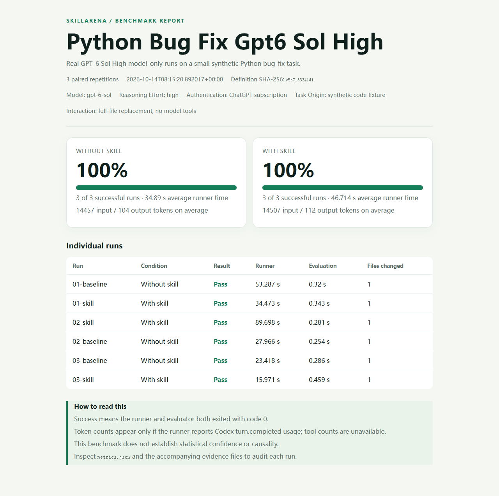

# SkillArena

**Does an AI skill actually improve an agent's work? Test it on the same task, in separate workspaces, and keep the evidence.**

SkillArena is an early-stage, local A/B benchmark tool. It runs a command-based agent with and without a skill, evaluates both results, and creates a shareable HTML report with per-run logs and artifacts. It does not host models or execute cloud jobs.

[中文说明](README.zh-CN.md)

## First real-model result

We ran **GPT-6 Sol, high reasoning effort** on a small Python bug fix, three times per condition using the existing ChatGPT login. The task fixture is synthetic; the model runs are real.

| Condition | Successful runs | Mean input tokens | Mean runner time |
| --- | ---: | ---: | ---: |
| Without skill | 3/3 | 14,457 | 34.9 s |
| With skill | 3/3 | 14,507 | 46.7 s |

**Observed success-rate change: 0 percentage points.** This task was easy for the model, and three pairs do not support a broad claim about skills or latency. Read the [experiment, raw metrics and per-run evidence](research/gpt6-sol-high-2026-10-14/README.md).



> **Honest demo:** The included `demo_agent.py` is a deterministic fixture, not an AI model. Its 0% → 100% result shows the workflow only. No real-world performance claim follows from it.

## Try it in five minutes

Requires Python 3.11+ and a trusted local checkout.

```bash
git clone https://github.com/Cyber-Marty/SkillArena.git
cd SkillArena
python -m venv .venv
# Activate .venv for your shell, then:
python -m pip install -e .
skillarena run examples/demo.yaml --output results/demo
```

Open `results/demo/report.html` in a browser. The same directory contains `metrics.json`, `logs/`, and an isolated workspace for each run under `artifacts/`.

The demo prints:

```text
Benchmark: python_bug_fix_demo
Baseline: 0/3
With skill: 3/3
Report: .../results/demo/report.html
```

The numbers are **synthetic**. Replace the demo runner and fixture before drawing any conclusion about a real skill.

## How it works

```text
Benchmark YAML ──> fresh task copy ──> agent command ──> external evaluator
                       │                 │                    │
                       └── baseline and skill, repeated ──────┘
                                           │
                              metrics.json + logs + report.html
```

Each condition starts from the same source files. The run order alternates between repetitions. The evaluation command lives outside the copied task workspace, so a normal agent edit cannot silently rewrite the checker. A run succeeds only if the runner and evaluator both exit with code `0`.

## Define a benchmark

```yaml
name: my_bug_fix
description: Test whether a debugging skill helps on a fixed task.
task:
  source: fixture
  prompt: Fix the bug in calculate.py.
skill: skill.md
runner:
  type: command
  command: [python, "{benchmark_dir}/my_agent.py"]
evaluation:
  command: [python, "{benchmark_dir}/evaluate.py"]
repetitions: 5
timeout_seconds: 60
```

`{benchmark_dir}` expands to the directory containing the YAML file. Both commands run with the copied task directory as their current working directory. The runner receives:

| Environment variable | Meaning |
| --- | --- |
| `SKILLARENA_TASK_DIR` | Path to this run's fresh task copy |
| `SKILLARENA_TASK_PROMPT` | Task text from the YAML file |
| `SKILLARENA_SKILL_PATH` | Absolute skill file path for the skill arm; empty for baseline |
| `SKILLARENA_ARM` | `baseline` or `skill` |

The same command runs for both conditions. An adapter can call any installed agent CLI or model SDK and should log its own token and tool counts if available. SkillArena's generic command adapter leaves these metrics as `null`; it never estimates them.

Benchmark files execute local commands. **Run only definitions you trust.** Keep evaluation logic outside `task.source` and do not allow the agent to edit it.

## CLI

```bash
skillarena init my-benchmark                # copy the starter fixture
skillarena run my-benchmark/benchmark.yaml --output results/experiment-1
skillarena report results/experiment-1/metrics.json
skillarena compare results/experiment-1 results/experiment-2
```

To rerun the real-model example, use `skillarena run examples/real_codex.yaml --output results/my-real-run`. It requires a current Codex CLI signed in with ChatGPT. Set `SKILLARENA_CODEX_BIN` to the CLI executable if your shell resolves an older version. The adapter refuses API-key authentication and asks the model for a full-file replacement in a read-only session; SkillArena writes and evaluates the returned code locally.

Choose a new output directory for each run. `results/` is ignored by Git to avoid publishing generated code or private model logs by accident.

## Read results responsibly

The headline metric is the fraction of successful runs per condition, with the absolute percentage-point difference. The report also shows per-run duration and changed file counts. The raw JSON records exit codes and timeouts. A few repetitions do not prove a skill helps generally: use multiple representative tasks, hold model settings fixed, record model versions and costs in your external adapter, and inspect failures. See [benchmark methodology](docs/methodology.md).

## Status and roadmap

**Available now:** YAML definitions, isolated local runs, command adapter, exit-code evaluation, JSON metrics, logs, artifacts, self-contained HTML report, starter benchmark, and CI.

**Planned:** broader model adapters, richer evaluators, task suites, and uncertainty estimates across multiple tasks. These are not implemented yet. This repository is not published on PyPI; install from the checkout as shown above.

Contributions are welcome. Start with [CONTRIBUTING.md](CONTRIBUTING.md), especially if you can provide a small, independently checkable task fixture. MIT licensed.
